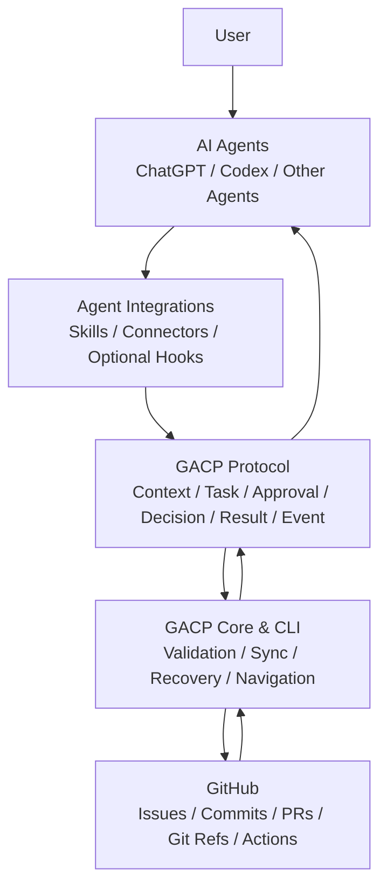

# GACP — GitHub Agent Collaboration Protocol

<p align="center">
  <strong>A Shared Protocol for AI Agent Collaboration</strong>
  <br />
  Let AI agents collaborate, share context, coordinate tasks, and preserve project knowledge through GitHub.
</p>

<p align="center">
  <a href="https://github.com/Iraexile/GACP">
    
  </a>
  <a href="https://github.com/Iraexile/GACP/blob/design/phase-0-1/SPEC.md">
    
  </a>
  <a href="https://json-schema.org/draft/2020-12">
    
  </a>
  
</p>

**GACP (GitHub Agent Collaboration Protocol)** is an open, GitHub-backed protocol designed to enable multiple AI agents to collaborate on the same software project.

It provides a shared structure for project context, task management, user authorization, technical decisions, execution results, and synchronization.

Instead of relying on isolated conversations or agent-specific memory, GACP uses GitHub as a persistent collaboration layer.

**Agents may change. Project knowledge should persist.**

> **Project Status:** Phase 0/1 — Protocol and Architecture Design
>
> GACP is currently a design-stage project. The protocol specification and schema drafts are available, but the CLI, agent skills, synchronization tools, and end-to-end integrations have not yet been implemented or validated.

---

## 📦 What's Included

GACP is designed around five core collaboration concepts:

| Component | Purpose |
|---|---|
| **Project Context** | Shared project background, goals, constraints, and technical knowledge |
| **Task** | Structured tasks with dependencies, acceptance criteria, and lifecycle management |
| **Approval** | Explicit, verifiable user authorization before execution |
| **Decision** | Persistent technical decisions and their rationale |
| **Result** | Structured execution reports, code references, tests, and evidence |
| **Event** | Append-oriented records of task lifecycle transitions and observations |

The current protocol schema defines **8 object kinds and 15 event types**, including state-transition and observational events.

The repository currently includes:

- Protocol specification and data model.
- JSON Schema definitions and validation examples.
- Task lifecycle and authorization rules.
- Definition hashing and integrity specifications.
- GitHub-based concurrency and synchronization design.
- Agent integration architecture and technical research.
- Independent experiments and end-to-end acceptance plans.

---

## 📋 Table of Contents

- [Why GACP?](#-why-gacp)
- [How It Works](#-how-it-works)
- [Getting Started](#-getting-started)
- [Security and Trust Model](#-security-and-trust-model)
- [Quick Examples](#-quick-examples)
- [Use Cases](#-use-cases)
- [Protocol Overview](#-protocol-overview)
- [Architecture](#-architecture)
- [Project Status](#-project-status)
- [Repository Structure](#-repository-structure)
- [Contributing](#-contributing)
- [FAQ](#-faq)
- [License](#-license)

---

## 🚀 Why GACP?

### The Problem: Isolated AI Agents

Modern AI agents are increasingly capable of handling different parts of software development.

For example:

- ChatGPT can research, analyze requirements, design architectures, and review code.
- Codex can implement features, debug problems, run tests, and modify repositories.
- Other agents can specialize in documentation, data analysis, testing, or research.

However, these agents often operate independently.

This creates several problems:

- **Context Fragmentation** — Project knowledge is scattered across conversations, files, and tools.
- **Repeated Handoffs** — Users must manually transfer tasks and execution results between agents.
- **Lost Decisions** — Important technical decisions disappear into conversation history.
- **Unreliable State** — Agents cannot reliably determine what has already been completed.
- **Limited Traceability** — Task descriptions, code changes, and validation evidence are disconnected.
- **Session Dependency** — Starting a new conversation often means reconstructing the entire project context.

The problem is not that individual agents cannot perform tasks.

The problem is that they lack a common collaboration protocol.

### The Solution: A Shared Collaboration Layer

GACP introduces a common protocol that allows different agents to work around the same GitHub project.

<pre>
       ChatGPT                 Codex
   Research & Design       Coding & Testing
          │                     │
          └──────────┬──────────┘
                     │
                     ▼
          GitHub Agent Collaboration
                  Protocol
                     │
          ┌──────────┴──────────┐
          │                     │
      Project Context       Task Management
          │                     │
      Decisions             Approvals
          │                     │
          └──────────┬──────────┘
                     │
                     ▼
             Persistent Results
             & Execution History
</pre>

GACP aims to make collaboration:

- **Persistent** — Project knowledge survives individual conversations and agent sessions.
- **Interoperable** — Different agents can exchange information through a common protocol.
- **Traceable** — Tasks, decisions, approvals, code changes, and results remain linked.
- **Controlled** — Users retain authority over task approval and execution.
- **Extensible** — New agents and tools can join without redesigning the entire system.

### Core Design Principles

| Principle | Description |
|---|---|
| Agent-neutral | No dependency on a particular model or agent vendor |
| GitHub-backed | Reuse GitHub Issues, Git, Commits, PRs, and Actions |
| Single source of truth | Every important data category has a defined authoritative source |
| User-controlled | Agents cannot independently grant themselves execution permission |
| Persistent context | Project knowledge is independent of chat history |
| Verifiable results | Execution reports retain links to actual evidence |
| Minimal infrastructure | Avoid introducing an unnecessary independent database or platform |

---

## 🎯 How It Works

GACP is designed around a simple collaboration lifecycle:

1. An agent reads the project's context and previous work.
2. An agent proposes a task with its rationale, scope, and acceptance criteria.
3. The user reviews and explicitly approves the task.
4. An execution agent retrieves the authorized task.
5. The agent performs the work and produces code changes and test evidence.
6. The result is published to GitHub and associated with the original task.
7. Other agents retrieve the latest project state and continue working.

### User Authorization

GACP distinguishes between proposing a task and authorizing its execution.

Users should be able to:

- **Approve** — Authorize the task within its specified scope.
- **Defer** — Postpone execution without granting permission.
- **Explore** — Discuss the task further, examine alternatives, and clarify risks.

Exploring a task does not constitute approval.

An agent must not interpret a conversation, an informal suggestion, or its own task proposal as execution authorization.

---

## 🎯 Getting Started

**Current limitation:** GACP is not yet available as an installable product. The following steps describe how to explore and review the current design.

### Step 1. Understand the Protocol

Start with the core specification:

- [SPEC.md](SPEC.md) — Protocol objects, authority, state machine, authorization, synchronization, and error handling.

### Step 2. Explore the Architecture

Read the system design:

- [ARCHITECTURE.md](docs/ARCHITECTURE.md) — Components, technology choices, and integration boundaries.
- [RESEARCH.md](docs/RESEARCH.md) — Technical research and existing project comparisons.

### Step 3. Inspect the Data Model

Explore the protocol schema:

- [JSON Schema](schemas/gacp-v1.schema.json)
- [Schema Documentation](schemas/README.md)
- [Definition Hash Specification](docs/DEFINITION_HASH.md)
- [Protocol Examples](docs/PROTOCOL_EXAMPLE.md)

### Step 4. Review Current Capabilities

- [Capability Matrix](CAPABILITY_MATRIX.md)
- [Verification Records](docs/VERIFICATION.md)
- [Design Check Results](docs/DESIGN_CHECK_RESULTS.json)

These documents distinguish implemented or verified capabilities from theoretical feasibility and pending experiments.

### Step 5. Follow Development

- [Phase 0/1 Review](PHASE_0_1_REVIEW.md)
- [Acceptance Plan](docs/ACCEPTANCE_PLAN.md)

---

## ⚠️ Security and Trust Model

Security is a fundamental part of GACP's design.

AI agents should not automatically receive unrestricted access to a project simply because they participate in its collaboration workflow.

### User Authorization

- Task execution requires explicit authorization.
- Approval is bound to a specific task definition, attempt, and execution scope.
- Changes to approved task definitions invalidate previous approvals.
- High-risk operations require separate authorization.
- Agents must verify authorization before execution and recovery.

### Data Protection

GACP follows a minimal-data principle.

It does not require automatically uploading:

- API keys, access tokens, or credentials.
- Model weights or private datasets.
- Entire conversation histories.
- Unnecessary environment variables or private files.

### Untrusted Inputs

External Issues, comments, logs, and other agent-generated content must be treated as untrusted input.

They must not automatically become executable commands or trusted instructions.

### Integrity and Traceability

GACP uses structured events, unique identifiers, definition hashes, fixed Git references, and execution evidence to improve consistency and traceability.

GitHub is not an immutable audit system, and GACP does not claim cryptographic protection against repository administrators or an unconditional zero-leak guarantee.

---

## 💡 Quick Examples

The following are conceptual workflows illustrating the intended experience. They are not currently executable integrations.

### Example 1. ChatGPT → GitHub → Codex

**Research and planning followed by implementation.**

```text
User:
  Discusses a feature with ChatGPT.

ChatGPT:
  Analyzes the project.
  Proposes a structured implementation task.

User:
  Reviews and approves the task.

GitHub:
  Stores the task and authorization.

Codex:
  Retrieves the authorized task.
  Implements the feature.
  Runs tests and publishes evidence.

GitHub:
  Stores the result and code references.
```

### Example 2. Codex → GitHub → ChatGPT

**Execution results become shared project knowledge.**

```text
Codex:
  Completes a task.
  Publishes commits, tests, and results.

GitHub:
  Preserves the execution history.

ChatGPT:
  Retrieves the latest project state.
  Reviews the changes.
  Identifies remaining issues.
  Proposes the next task.
```

### Example 3. New Session Recovery

**Continue a project without reconstructing old conversations.**

```text
New ChatGPT Session
        │
        ▼
  Locate GitHub Project
        │
        ▼
  Read Project Context
        │
        ▼
  Retrieve Decisions
        │
        ▼
  Inspect Tasks and Events
        │
        ▼
  Retrieve Latest Results
        │
        ▼
  Continue Collaboration
```

The goal is to make GitHub project data sufficient to reconstruct the relevant working state, without depending on the original conversation transcript.

---

## 🔬 Use Cases

### Software Development

Coordinate architecture discussions, implementation tasks, debugging, testing, and code reviews across multiple agents.

### AI Research Projects

Preserve research context, experimental decisions, implementation details, and reproducibility evidence across different agents and sessions.

### Multi-Agent Workflows

Allow specialized agents to collaborate through shared tasks and results without requiring all agents to use the same model or execution environment.

### Long-Term Projects

Maintain project knowledge and execution history even when individual agents, models, or conversations change.

### Multi-Repository Development

Support independent GACP workspaces for multiple projects, with separate identities, tasks, permissions, and synchronization state.

---

## 🧩 Protocol Overview

GACP separates collaboration data into several object types.

| Object | Main responsibility |
|---|---|
| Project | Stable project identity and authorization policy |
| Context | Background, goals, constraints, and technical knowledge |
| Task | Work definition and acceptance criteria |
| Approval | Verifiable authorization |
| Decision | Confirmed technical decisions |
| Result | Execution report and supporting evidence |
| Claim | Execution ownership and attempt information |
| Event | Task lifecycle and observational records |

### GitHub as the Shared Source of Truth

Different data categories have different authoritative locations.

| Data | Authoritative source |
|---|---|
| Project identity and context | Reviewed project repository files |
| Task definitions and lifecycle | GitHub Issues and valid event comments |
| Technical decisions | Reviewed Git commits |
| Execution results | Fixed result references in Git commits |
| Source code changes | Commits and Pull Requests |
| Current status | Reconstructable project status snapshot |

GACP does not treat a chat transcript or an independently maintained task database as the authoritative project state.

---

## 🏗️ Architecture

GACP uses a layered architecture to separate protocol rules from agent-specific integrations.



*Target architecture; implementation and integration validation are still pending.*

### Architecture Layers

**1. Agent Layer**

Existing AI agents handle research, planning, coding, testing, and review.

**2. Integration Layer**

Agent-specific Skills, connectors, and optional hooks provide access to GACP workflows.

**3. Protocol Layer**

Defines the shared data structures, authorization rules, task lifecycle, and synchronization semantics.

**4. Core and CLI Layer**

Provides reusable validation, repository navigation, synchronization, error handling, and recovery mechanisms.

**5. GitHub Layer**

Provides persistent storage and native collaboration primitives.

The protocol itself should not depend on a specific CLI, Skill, model, or IDE.

---

## 📈 Project Status

**Current stage: Phase 0/1 — Design and Specification**

| Phase | Description | Status |
|---|---|---|
| Phase 0 | Feasibility research and technology selection | Completed design work |
| Phase 1 | Protocol, Schema, and architecture design | Design published; final review pending |
| E0 | Independent ChatGPT write experiment | Pending design approval |
| Phase 2 | Core CLI, initialization templates, and agent Skill | Not started |
| Phase 3 | Multi-project and reliability validation | Not started |
| Phase 4 | End-to-end cross-agent acceptance testing | Not started |

### Current Limitations

- No installable CLI.
- No released GACP Skill.
- No synchronization daemon or service.
- No implemented GitHub Actions workflow.
- No validated automatic ChatGPT ↔ GitHub ↔ Codex loop.
- No completed two-project isolation or fault-recovery tests.
- No completed fresh-session recovery test.

See the [Capability Matrix](CAPABILITY_MATRIX.md) for detailed evidence and limitations.

---

## 📂 Repository Structure

```text
GACP/
│
├── README.md
├── SPEC.md
├── CAPABILITY_MATRIX.md
├── PHASE_0_1_REVIEW.md
│
├── schemas/
│   ├── README.md
│   ├── gacp-v1.schema.json
│   └── vectors/
│
└── docs/
    ├── ARCHITECTURE.md
    ├── RESEARCH.md
    ├── VERIFICATION.md
    ├── ACCEPTANCE_PLAN.md
    ├── CHATGPT_WRITE_EXPERIMENT.md
    ├── DEFINITION_HASH.md
    ├── GIT_REF_CONCURRENCY_PLAN.md
    ├── PROTOCOL_EXAMPLE.md
    └── DESIGN_CHECK_RESULTS.json
```

---

## 🤝 Contributing

GACP is currently in the design stage.

Contributions and discussions are welcome, especially in the following areas:

- Agent-neutral protocol design.
- GitHub-based collaboration and synchronization.
- Task authorization and lifecycle management.
- Data integrity and concurrency control.
- Cross-agent interoperability.
- Multi-project isolation and recovery.
- Security and permission boundaries.

### How to Contribute

1. Read the [protocol specification](SPEC.md).
2. Review the [architecture](docs/ARCHITECTURE.md).
3. Check existing design discussions and known limitations.
4. Open a GitHub Issue to propose changes or discuss an idea.
5. Submit a Pull Request for changes that have been discussed and agreed upon.

Please distinguish proposed features from implemented and verified capabilities.

---

## ❓ FAQ

### Is GACP an AI agent?

No. GACP is a collaboration protocol and supporting tool architecture. It does not provide its own AI model or agent runtime.

### Does GACP replace GitHub Issues?

No. GitHub Issues are part of the underlying task management and lifecycle infrastructure.

### Does GACP require ChatGPT and Codex?

No. They are representative examples. GACP is designed to be agent-neutral.

### Does GACP automatically synchronize every agent?

Not currently. Automatic synchronization is a design goal, not an implemented capability. Actual behavior will depend on available integrations, permissions, and validated execution mechanisms.

### Does GACP require a separate database?

The current design prioritizes GitHub as the shared persistence layer and avoids introducing an independent task database.

### Can I install GACP today?

Not yet. The protocol and design artifacts are available for review, but there is no released installation package.

### Are the JSON examples real tasks?

No. The protocol examples and schema vectors contain fictional test fixtures. Structural validity does not imply real authorization or execution.

---

## 📄 License

The project license has not yet been finalized.

A license will be selected and published before the first public implementation release.

---

<p align="center">
  <strong>GACP</strong>
  <br />
  A shared protocol for agents.
  <br />
  Persistent knowledge for projects.
  <br />
  Control in the hands of users.
</p>
