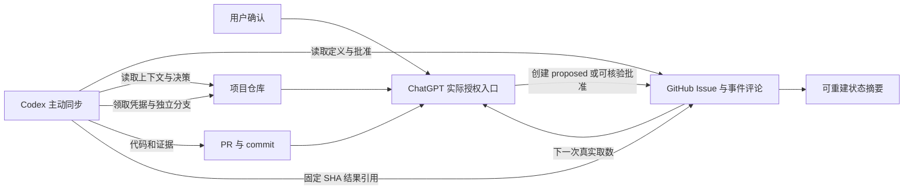

# 架构设计提案

状态：待审核；下列组件除 GitHub 与现有授权工具外均未实现。

## 数据与控制边界

GitHub 是共享持久层，ChatGPT 会话不是副本数据库。没有数据复制到公共 GACP 协议仓库的后台通道。每个项目独立启用、独立授权；账号连接不自动继承到其他产品。

## 最小组件

| 组件 | 职责 | 复用/新增 |
|---|---|---|
| GitHub Issues、PR、Git、Actions | 权威对象、审查和可选事件运行 | 直接复用原生能力 |
| GitHub 原生插件或官方 MCP | 实际读写传输 | 优先复用；按产品实际工具与授权检查 |
| 协议核心库 | 对象解析、状态折叠、引用校验、错误及幂等 | 未来仅实现协议专有规则 |
| 轻量 CLI | 统一项目定位、可靠读写、outbox 与诊断 | 后续新增；不构建另一个任务平台 |
| 全局 gacp-sync Skill | 开始前恢复、确认范围、结束后结构化汇报的行为规范 | 后续新增；不负责底层可靠性 |
| Hooks/执行包装器 | 已启用任务结束后的发布触发 | 可选，必须在实际版本与权限下验证 |
| 少量 Actions | 协议/引用校验、摘要 PR | 可选，先证明价值再实现 |
| 自建 MCP 适配器 | 只补已有入口无法提供的最小协议工具 | 非默认，不在本阶段实现 |

## 技术选择

建议 TypeScript + Node LTS，编译产物作为单个 npm 包；理由是 Windows/跨平台进程和路径处理统一、JSON Schema/Ajv 生态成熟、可共享 MCP/CLI 类型。本机只有 Node 被实际发现；这不证明 Python 不支持。Python 仍是合理备选，但不同时维护两个 SDK。最低 Node 版本要在实现阶段依目标 LTS 与依赖兼容矩阵确定。

拟用成熟 JSON Schema validator（如 Ajv 2020 模式）和 RFC8785 canonicalizer，不自行实现通用解析器/加密库。Markdown 元数据用安全 YAML 子集解析，禁用自定义类型；Issue 直接 JSON，避免 YAML 类型歧义。依赖版本和许可证在编码时固定并核实；本阶段未安装项目运行依赖；仅在临时目录下载固定版本的离线设计校验库，未加入项目依赖。

Git 使用参数数组调用；不用 shell 拼接、不依赖 bash、避免 Windows 命令行秘密参数。GitHub REST 由一层 transport 封装；认证优先现有 GitHub App/MCP 或 gh auth（如用户已安装），独立使用 fine-grained token 是备选；gh 不作为强制依赖。凭证存 OS/宿主凭证设施，不写项目配置、不写 outbox、不在诊断中枚举环境变量。

最小权限分离：只读者 Metadata/Contents/Issues/PR read；任务发布 Issues write；执行/结果发布另需 Contents write、必要 PR write；Actions 仅选择所需 job 权限，不需管理员。项目规则可能限制领取 ref；doctor 必须报告并停止，不自动修改规则。协议仓库当前连接返回 admin 不是工具运行的权限要求。

## CLI 接口设计（不是可执行命令）

拟保留 init/status/tasks/publish-task/claim/report/sync/doctor；支持 --repo、--json、--non-interactive、--dry-run。init 从显式 repo 或 git remote 解析并核实稳定 ID，拒绝对非 Git 目录/模糊多 remote 自动猜测；只增加通用协议文件，提出审查 PR，不覆盖已有 AGENTS.md。新项目需提供背景、审批者和权限确认，技术栈不进入协议代码。

sync 默认读取/协调待发协议数据，不自动执行新任务；执行需批准+领取。report 先保存真实证据再发布；dry-run 不领取、不建 Issue、不推送。失败返回非零、机器错误码和可操作原因；“无新任务”是成功空结果。具体退出码表待实现确定。

拟定分发：npm 全局安装版本固定的包；一份 Skill 安装到官方用户级 ~/.agents/skills/gacp-sync（Windows 为 %USERPROFILE%\.agents\skills\gacp-sync），或后续作为插件分发。不是每项目复制 Skill；项目仅维护 .gacp 配置与少量 AGENTS.md 发现说明。升级须显式并显示版本/变更；目前没有可安装包或 Skill。

## 同步触发的四个层次

1. 最小可用：用户在 Codex 发起任务/同步，或显式调用 Skill；无需常驻服务。
2. 确定性执行包装器：围绕一次受授权 codex exec 收集退出/报告，处理发布重试。不能把进程退出 0 当测试通过。
3. 可选已信任 SessionStart/Stop Hooks：只读取结构化 GACP checkpoint/outbox，检查项目已启用；不上传 transcript。Stop 不是业务任务完成，重复调用要幂等并防递归。进程强杀/宿主退出/权限拒绝仍需下次恢复。
4. 可选 GitHub 事件执行器：Actions 或官方适用 Work 事件任务。先过滤受信身份与当前批准，再隔离运行。GitHub 事件不会自动唤醒本地 Codex；调度/凭证/API 费用需单独批准。

不把 SessionEnd 当唯一网络发布入口（官方文档该事件超时很短）。Hooks 的云端/本地支持并不相同；云协调文档限制本地 command hook，不应一份配置宣称覆盖所有产品。

## ChatGPT 接入决策树

真实写入按 [E0 独立早期实验](CHATGPT_WRITE_EXPERIMENT.md) 执行，在正式 CLI/Skill 开发投入前核实；本地模拟和 Codex 代写不计通过。

先在用户实际会话发现 GitHub 工具。若可按 Issue URL/评论和固定 SHA 读取，采用原生入口；若有 create_issue，先做用户确认测试再验证远程回执，不能只看工具名字。无写入时，尝试适用账号的官方托管 GitHub MCP，检查 OAuth host、暴露工具、Issues write 和用户确认。

若目标账号不具备自定义 MCP 写能力，自建适配器也不解决权限问题：停止该路线。最小替代是预填 GitHub 新建 Issue 页面，让用户检查后点击提交；批准评论由用户本人发布。也可用户明确让已授权 Codex 发布，仍注明不是 ChatGPT 原生写入。预填链接只含用户同意公开的任务字段，不嵌令牌或私密对话。

自建适配器只有在实验证明“账号可写 MCP，但官方现成入口缺少必要工具/可信批准回执”后才进入候选，工具限定 read_context/list_tasks/publish_proposal/report_receipt，不建 Dashboard、数据库、账号体系。先提交针对写入缺口的实验报告与部署成本，再决定是否实现。

## 维护成本与取舍

核心不引入 Beads/Dolt/tmux/调度集群，保留 Beads/Gas City 外链适配边界。单任务领取回执 ref 是为了避免 Issue 非原子领取；代价是额外 Git ref、Contents write 和人工故障接管。先用小规模项目验证，无需自动 GC。若 ref 数量/规则成为实际障碍，再比较受信单写 Actions 调度器，不能静默取消互斥。

不保证 GitHub 多对象事务、永远在线、恰好一次任意并发 Issue 创建或管理员防篡改。失败是显式状态和持久回执，不隐藏在“同步成功”一句话中。
